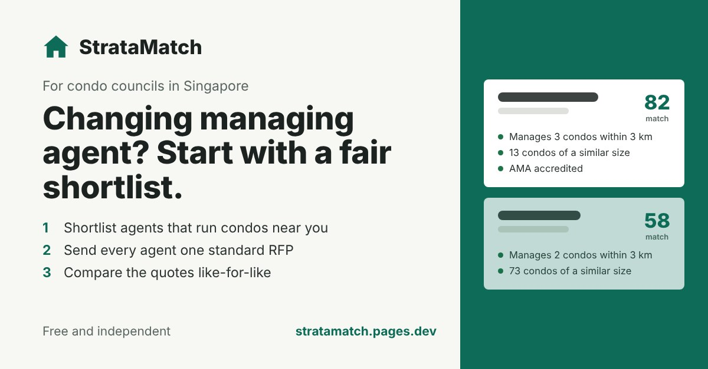
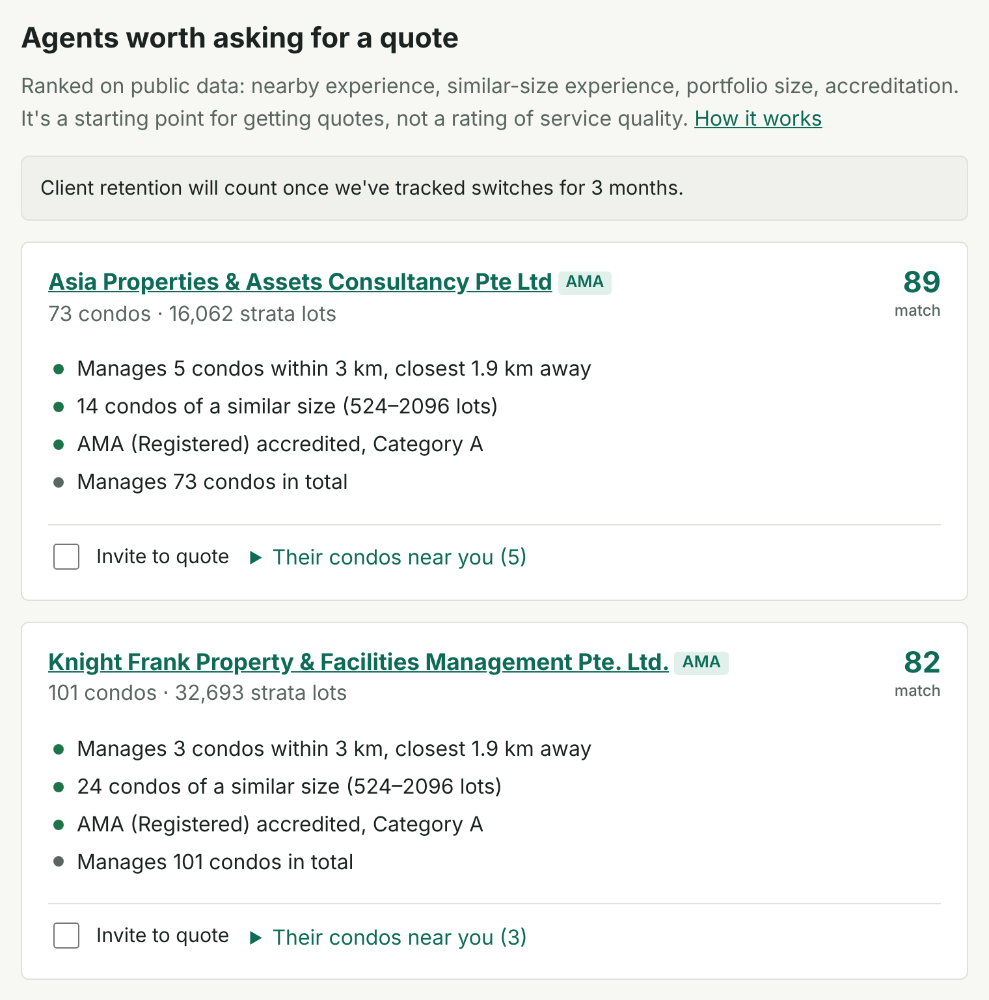
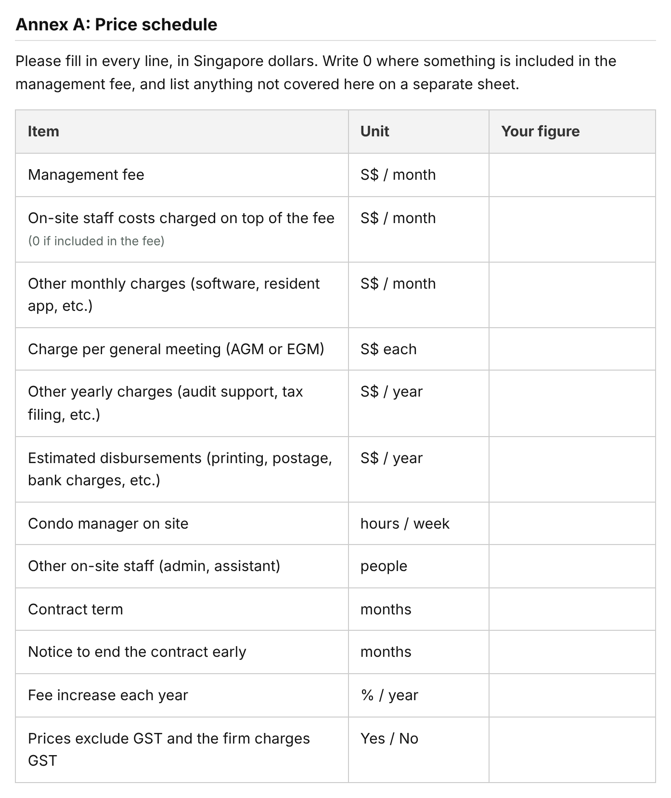
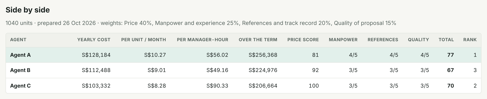

# StrataMatch

A free tool for condo councils in Singapore that are changing managing agent.

### **[Open StrataMatch →](https://stratamatch.pages.dev)**

Came from LinkedIn?

 

Hi! Thanks for clicking through. If you're on a condo council, try it on your own condo and tell me what's off. Message me on LinkedIn.

**[Open StrataMatch with a hello →](https://stratamatch.pages.dev/?hi=linkedin)**

Sahaj

When my condo changed managing agents, I realised the council (unpaid volunteers with day jobs) was starting the search from word of mouth. There's no easy list of which agents already run condos near you, and every quote comes back in a different format.

## What it does

**1. Shortlist agents worth asking for a quote.** Pick your condo and see up to 6 agents, each with the reason: the condos they run near you, condos of a similar size, accreditation and portfolio size.

**2. Send every agent one standard RFP.** Fill in your condo, scope and start date. You get a timeline worked back from that date and a request for proposal with one price schedule every agent fills in. Print it, save it as PDF or download it for Word.

**3. Compare the quotes like-for-like.** Type in each price schedule to see the yearly cost with GST, the cost per unit and per condo-manager hour, and a weighted score.

It also makes the process transparent for owners: the council can show how agents were shortlisted, that every agent quoted on the same terms, and how the final choice was scored.

## Free and independent

- No agent pays to be listed or ranked.
- No accounts and no tracking. What you type stays in your browser.
- Public data only: BCA's list of every condo's managing agent, URA's land-use map and OneMap. [How the shortlist works](https://stratamatch.pages.dev/methodology).

## Under the hood

Built with Claude Code. Plain HTML and JavaScript with no build step, refreshed from data.gov.sg every month by a GitHub Action, and hosted free on Cloudflare Pages. The code, data pipeline and tests are in [`ma-shortlist/`](ma-shortlist/); see its [developer notes](ma-shortlist/README.md).

Also in this repo: `redirect/` forwards old links for a workout tracker that moved to its own repo.
